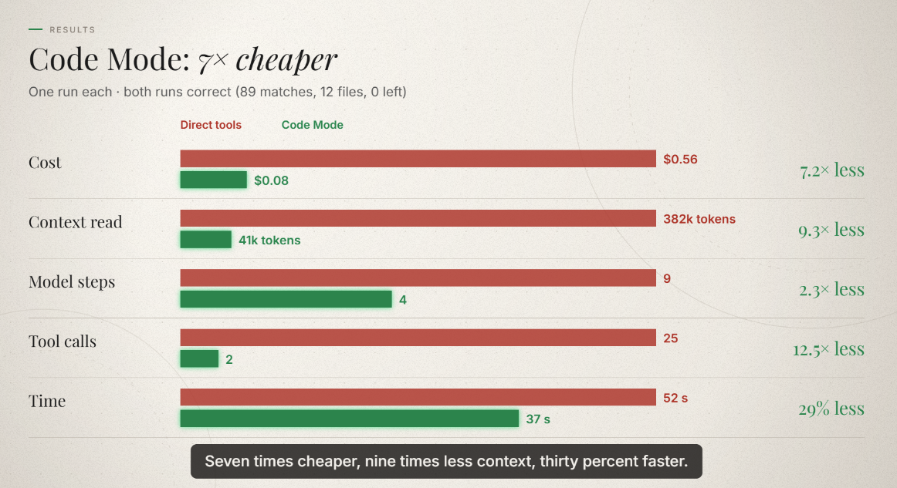

# OpenCode Code Mode: achieving parity with Claude's Code Mode

Date: 2026-11-19 · OpenCode v2.2.7 · Model: Claude Opus 5.5

## Overview

On 11/18, Claude instroduced an experiemental "code mode", a method for using tool that reduces costs and increases speed. However, much of the functionality already exists in Opencode. Like Claude, OpenCode's Code Mode (`execute`) has the model write one JavaScript script that calls many tools and returns only a summary. Unlike Claude's version, it couldn't reach the core file tools, so a small OpenCode plugin (`codemode-fs`) can easily achieve parity with Claude Code. The plugin adds `tools.fs.read/glob/grep/edit` to Code Mode, leaves the built-in tools untouched, and applies the same permission rules. 

On a search and replace across 124 CSV files (30 MB, 89 matches in 12 files), the Code Mode run was **about 7× cheaper ($0.08 vs $0.57)**, used **about 9× fewer context tokens**, and finished **about 30% faster (37 s vs 52 s)**, with identical correct results. The trade-off: the model sees less raw output, so it can miss side effects that the direct run pointed out. That makes Code Mode best for bulk work where the expected output is clear.



## Files

```
README.md                      this document
plugins/codemode-fs/index.ts   the plugin
```

## Install

Add the plugin folder to `plugins` in your global config, `~/.config/opencode/opencode.jsonc`, to load it in every project:

```jsonc
"plugins": [ ..., "<path-to-this-repo>/plugins/codemode-fs" ]
```

Don't put it under a project's `.opencode/` folder as well, or it loads twice. To turn it off for one project, add `"plugins": ["-codemode-fs"]` to that project's `opencode.jsonc`.

---

## 1. Background

### OpenCode vs Claude Code's Code Mode

Same core idea. The model writes JavaScript that calls several tools in one step, the harness runs it, and only the returned value goes back into context. Benefits: chained calls, parallel calls (`Promise.all`), local filtering of noisy output, and fewer model round trips. The idea comes from Cloudflare's "Code Mode", built mainly for MCP.

| | OpenCode V2 | Claude Code Code Mode |
|---|---|---|
| Entry tool | `execute` | `REPL` |
| Tools reachable from code | Catalog only: MCP servers (unless `codemode: false`), `opencode` namespace (sessions, worktrees, models), `browser`, plugin tools with `codemode: true`. Core tools (read/grep/edit/shell) are direct calls | Core tools (Bash, Read, Edit) plus MCP. Shell helper `` await $`rg ...`.text() `` |
| Discovery | `search()` finds tools on demand → smaller upfront context | Tools listed up front |
| Runtime | Confined: no imports, no filesystem, no timers. Has `fetch` | Runs in the session. JS plus its file, web and MCP calls run outside the Bash sandbox |
| Permissions | Nested built-in and MCP tools enforce their own rules. Plugin tools enforce only the permissions they assert | Deny/ask rules and PreToolUse hooks run per inner call. A hook on `REPL` can read `tool_input.code` |
| Status | Built in. Disable with a deny rule on `execute` | Experimental: `CLAUDE_CODE_EXPERIMENTAL_CODE_MODE=1` (v2.1.323+) |

### Why wrapper tools

A server plugin can put tools in the `execute` catalog with `options: { codemode: true }`. Marking the built-in tools that way removes them from the direct tool list, so every single read would have to go through `execute`. Instead, the plugin adds separate `fs` tools that only Code Mode sees, and each one checks permissions itself with `ctx.permission.assert`.

Only file tools were added. Code Mode wins when there are **many calls and a small answer**, and loses on single calls (the extra script, `JSON.parse`, less visibility).

## 2. The plugin

`plugins/codemode-fs/index.ts` registers the `fs` namespace with `options: { namespace: "fs", codemode: true }`. Paths inside the session folder are returned relative to it, and paths outside it are returned absolute.

| Tool | Returns (JSON string) | Permission asserted |
|---|---|---|
| `fs.read({ path, offset?, limit? })` | `{ path, content, startLine, endLine, totalLines, next }` | `read` on the path |
| `fs.glob({ pattern, path?, hidden?, limit? })` | `["rel/path", ...]` (default limit 200) | `glob` on the pattern |
| `fs.grep({ pattern, path?, include?, literal?, caseSensitive?, limit? })` | `[{ path, line, text }]` (default limit 100) | `grep` on the pattern |
| `fs.edit({ path, oldString, newString, replaceAll? })` | `{ path, replacements }` | `edit` on the path |

Details:
- **Permission resources match the built-ins** (location-relative path inside the project, absolute path outside, plus an `external_directory` check for outside paths), so existing rules apply unchanged.
- Pure Node (`rg` isn't required): a recursive directory walk plus a small glob-to-regex converter. Skips `.git`, `node_modules`, `.hg`, `.svn`, dotfiles (unless `hidden`), files containing NUL bytes (treated as binary), and files over **50 MiB**.
- `fs.edit` errors if the text is missing or matches more than once without `replaceAll`, and it doesn't run a formatter.
- Cancellation: the walker checks `context.signal`.

Usage in `execute`:

```js
const P = async (p) => JSON.parse(await p)
const hits = await P(tools.fs.grep({ pattern: "retryPolicy", include: "**/*.ts" }))
const files = await Promise.all([...new Set(hits.map(h => h.path))].map(p => P(tools.fs.read({ path: p }))))
await P(tools.fs.edit({ path: "src/a.ts", oldString: "maxAttempts: 3", newString: "maxAttempts: 5" }))
return files.map(f => `${f.path}: ${f.totalLines} lines`)
```

### Tests

Run in a test folder with deny rules for `read secret/*` and `edit locked.txt` (not included in this repo).

| Check | Result |
|---|---|
| `search({ namespace: "fs" })` lists `fs.read/glob/grep/edit` | ✅ |
| Built-in `read/grep/glob/edit` still direct, and no plain `tools.read` in the catalog | ✅ |
| grep → parallel reads → edit → re-read in one `execute` | ✅ |
| `fs.read secret/key.txt` (deny `read secret/*`) | ✅ `Permission denied: read` |
| `fs.edit locked.txt` (deny `edit locked.txt`) | ✅ `Permission denied: edit` |
| Read outside the project | Allowed, same as the built-ins (default `external_directory` allow) |
| Plugin loads in subfolders | ✅ |
| Manual test in the TUI | ✅ only `fs.*` calls, all nested under `execute` |

## 3. Benchmark: Code Mode (`fs.*`) vs direct tools

**Data:** 124 CSV files, 29.6 MB (largest 2.6 MB). Not included in this repo.
**Task (same prompt both runs):** *Find every occurrence of the exact, case-sensitive text 'Tools panel' across all files. Report how many files contain it, the total number of occurrences, and the top 3 files by count. Then replace every occurrence with 'All tools panel' in every file and verify none remain.* Shell banned in both. Run 1 used `execute` + `tools.fs`. Run 2 used direct tools only, with the plugin turned off.
**Ground truth** (counted with PowerShell): 89 matches in 12 files.
**Method:** `opencode run --auto --format json`, tokens and cost summed from the `step_finish` events, files restored from a clean copy between runs.

| | Code Mode (`fs.*`) | Direct tools | Ratio |
|---|---|---|---|
| Model steps | 4 | 9 | 2.3× |
| Tool calls | 2 `execute` (+1 skill) | 25 (2 glob, 10 grep, 12 edit, 1 skill) | 12× |
| Output tokens | 1,220 | 4,145 | 3.4× |
| Cache read tokens | 40,965 | 382,244 | 9.3× |
| Cache write tokens | 8,394 | 76,587 | 9.1× |
| Cost | **$0.079** | **$0.565** | **7.1×** |
| Wall time | **37 s** | **52 s** | 1.4× |
| Correct (89 matches in 12 files, 0 left) | ✅ | ✅ | |

**Why:** in the direct run, every grep result and edit sits in context and is re-sent on each of the 9 steps (cache read 382k). In Code Mode, the raw results stay inside the script and only a summary comes back.

**Quality trade-off:** the direct run saw every matching line and reported side effects: the existing text `All Tools panel` became `All All tools panel`. The Code Mode run made the same changes but never saw those lines, so it reported nothing. When side effects matter, have the script return the odd-looking matches (e.g. the text around each hit).

**Caveats:** 1 run each, 1 model, 1 task type (bulk search and replace). The `skill` call in both runs comes from a session-start hook, not the task.

## 4. Limitations

1. **Plugin tools return text only**, so scripts must call `JSON.parse`. Built-ins return objects.
2. No `fs.write` or `fs.shell`.
3. Search ignores `.gitignore` and is slower than `rg` on big repos.
4. Silent gaps in `fs.grep`: skipped files (binary, UTF-16, over 50 MiB) and cut-off results (`limit` reached) aren't reported.
5. Less visibility: the user sees one `execute` row, and the model sees only what the script returns.
